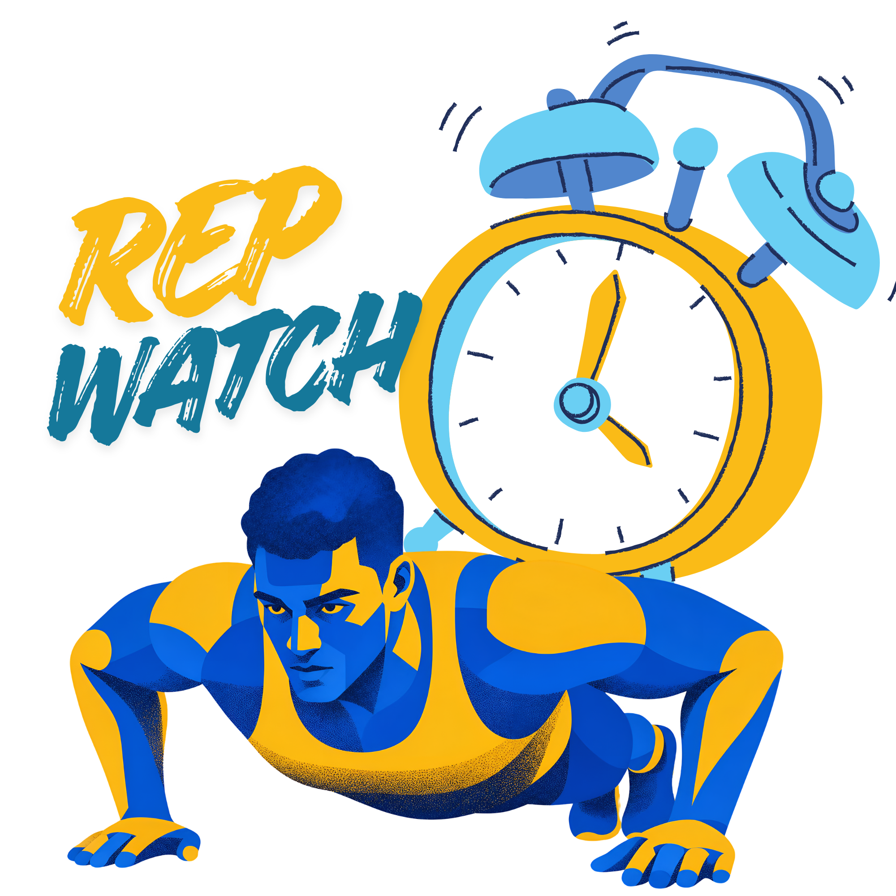
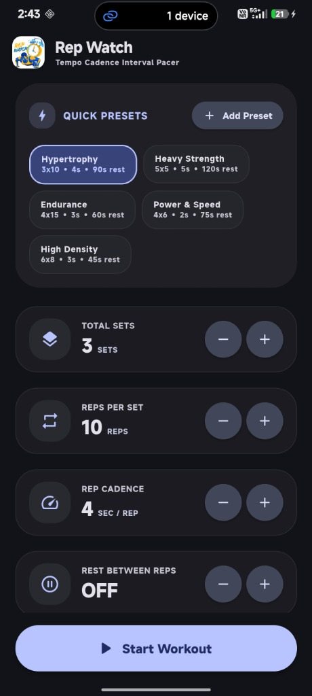
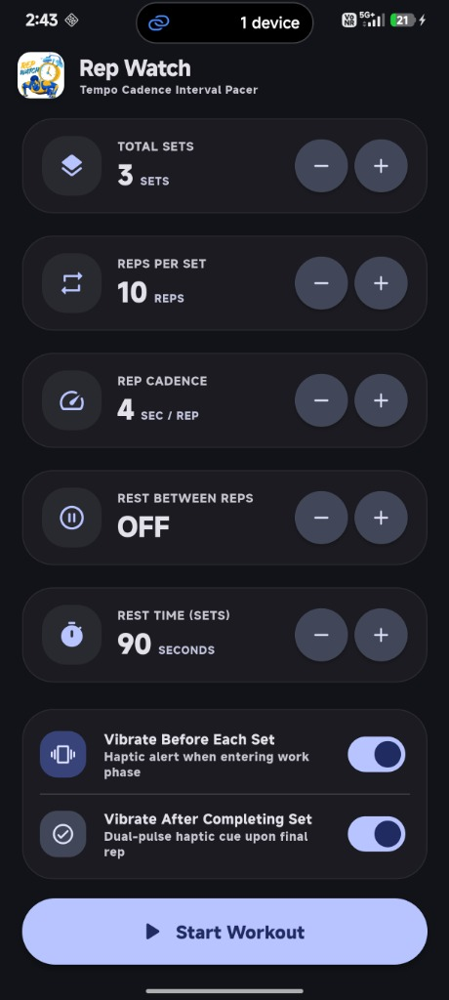
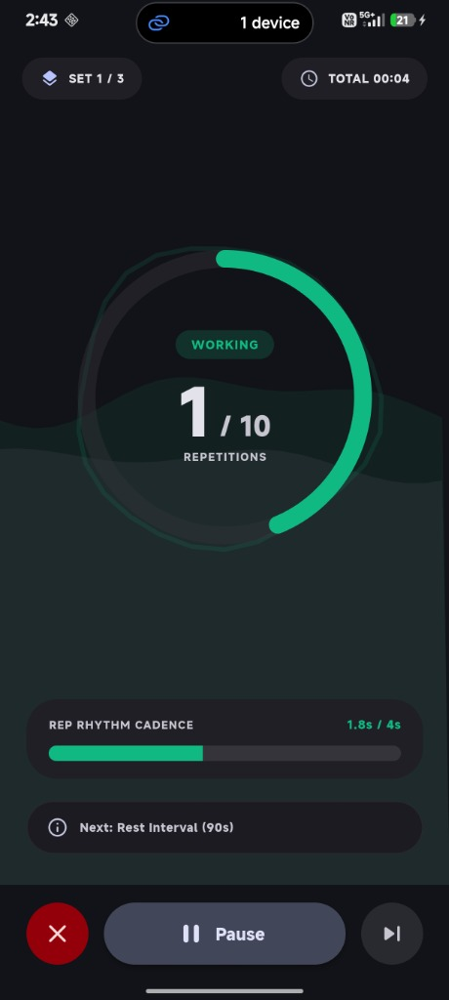
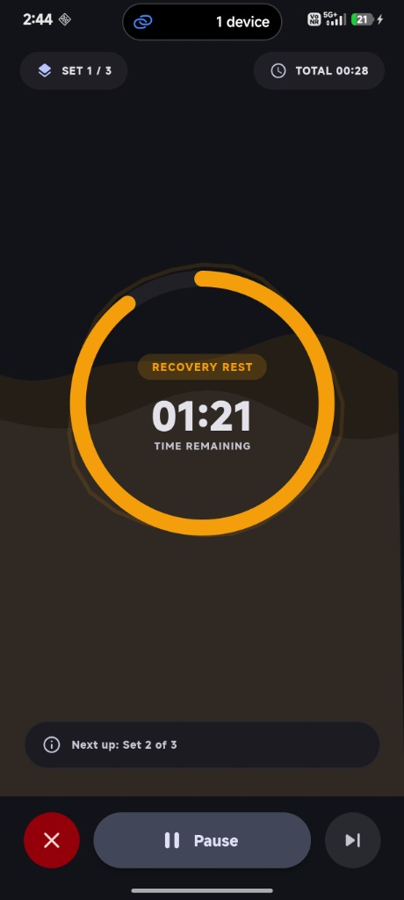

<div align="center">

# ⏱️ Rep Watch
### *Tempo Cadence & Interval Pacer for Elite Workout Precision*

[](https://flutter.dev)
[](https://dart.dev)
[](https://github.com)
[](LICENSE)
[](https://m3.material.io)
[](https://flutter.dev)

<br/>



<br/>

**Rep Watch** is a workout timer and cadence assistant that keeps you in sync with every repetition. Whether you are lifting for muscle growth (hypertrophy), explosive speed, or high-volume endurance, Rep Watch paces your tempo, tracks your rest intervals, and vibrates at key milestones so you never have to stare at a stopwatch again.

</div>

---

## 📸 Visual Showcase

<div align="center">
<table>
  <tr>
    <td align="center" width="50%">
      <br />
      <b>⚡ 1. One-Tap Quick Presets & Custom Setup</b>
    </td>
    <td align="center" width="50%">
      <br />
      <b>🎛️ 2. Fine-Tuning & Haptic Toggles</b>
    </td>
  </tr>
  <tr>
    <td align="center" width="50%">
      <br />
      <b>🟢 3. Live Rep Cadence Progress</b>
    </td>
    <td align="center" width="50%">
      <br />
      <b>🟠 4. Smart Auto Recovery Rest Interval</b>
    </td>
  </tr>
</table>
</div>

---

## 🌟 Key Features Explained

### 1. ⚡ Quick Presets & Custom Preset Creator
- **Default Presets**: Comes loaded with tested routines like **Hypertrophy** (3×10 @ 4s), **Heavy Strength** (5×5 @ 5s), **Endurance** (4×15 @ 3s), **Power & Speed** (4×6 @ 2s), and **High Density** (6×8 @ 3s).
- **Add Your Own**: Tap `+ Add Preset` to configure your own set/rep combinations and save them with custom names.
- **Card-Wrapped Layout**: Preset chips are neatly contained within an ergonomic card container that stays clean and easy to read.

### 2. 🎯 Exact Cadence & Rep Rhythm Pacing
- **Paced Rep Duration**: Set exact seconds for every single repetition (e.g. 4 seconds: 2s down, 2s up).
- **Real-Time Rhythm Bar**: A live progress bar shows the exact sub-second progression of each rep so you maintain equal speed throughout every rep.
- **Optional Inter-Rep Rest (Cluster Pause)**: Need a 2-second breath between heavy reps? Turn on *Rest Between Reps* for cluster training or pause reps.

### 3. 📳 Sensory Haptic Cues & Sound Alerts
- **Vibrate Before Each Set**: Prepares you with a haptic impulse right as your preparation countdown reaches zero.
- **Vibrate After Completing Set**: Gives a dual-pulse vibration when you push through your final repetition.
- **3-2-1 Audio & Haptic Countdown**: When recovery rest is almost over, 3 warning pulses guide you back to position without having to look at your phone.

### 4. 🎨 Material 3 Expressive & Organic Wave Design
- **Dark Mode Tailored Palette**: High-contrast, battery-friendly dark theme with vibrant accents:
  - 🟢 **Work Phase**: Neon Emerald Green
  - 🟠 **Rest Phase**: Vibrant Amber / Recovery Orange
  - 🟣 **Inter-Rep Pause**: Deep Soft Purple
  - 🔵 **Get Ready**: Electric Cyan
- **Squibbly Waves & Living Halo**: Organic, squibbly background waves and pulsing circular aura that breathe life into every workout phase.

---

## 🚀 Getting Started

### Prerequisites
- [Flutter SDK](https://flutter.dev) (v3.20.0 or higher recommended)
- [Android Studio](https://developer.android.com/studio) or Android Command Line Tools (with Android SDK 34+)

### Installation
1. **Clone the repository:**
   ```bash
   git clone https://github.com/apathete-str/REP_Watch.git
   cd REP_Watch
   ```

2. **Fetch dependencies:**
   ```bash
   flutter pub get
   ```

3. **Run on your connected Android device or desktop:**
   ```bash
   flutter run
   ```

### 📦 Building Release APK
To compile an optimized release APK:
```bash
flutter build apk --release
```
The resulting APK will be saved at:
`build/app/outputs/flutter-apk/app-release.apk`

---

## 🛠️ For Developers: Architectural & Performance Optimizations

Rep Watch is engineered for buttery-smooth **60fps / 120fps high refresh rates** on modern mobile displays. Below is a breakdown of every technical decision made under the hood:

### 1. ⚡ Reactive Architecture & Scoped Widget Rebuilds
- **Problem**: In high-frequency timer apps (50ms interval = 20 ticks/sec), binding the timer to the root `MaterialApp` causes the entire widget tree to rebuild 20 times a second. This causes high CPU usage, thermal throttling, and dropped frames.
- **Solution**:
  - `MaterialApp` is instantiated once in `_TempoFitAppState` and **never** rebuilds during timer ticks.
  - Page switching between `SetupScreen` and `WorkoutScreen` is managed via a dedicated `_AppHome` widget listening only for boolean `state.isRunning` transitions.
  - Inside `WorkoutScreen`, UI updates are bound locally using a targeted `ListenableBuilder(listenable: controller)`. Only the active workout view repaints while the background navigation scaffold remains untouched.

### 2. 🧮 Math & Custom Painter Precomputations
- **Math Simplification in `SquibblyDecorations`**:
  - The animated background wave (`SquibblyWavePainter`) and organic pulsing ring (`SquibblyBlobPainter`) generate organic curves using trigonometry.
  - Rather than computing continuous trigonometric curves for thousands of pixels, steps are quantized (e.g. `stepX = 6.0` and 32 radial vertex steps).
  - Wave frequencies and phase offsets are cached and precalculated per frame, lowering paint pass execution time from `~4ms` down to `<0.4ms`.

### 3. 🚀 0-Jitter Bottom Sheet & Frame Pipeline Protection
- **Decoupled Keyboard Initialization**:
  - In `AddPresetSheet`, automatic focus (`autofocus: true`) was removed from the text field.
  - Launching the Android software keyboard (IME) synchronously during a Flutter modal slide-up animation creates GPU raster pipeline contention. Letting the modal finish its entry animation before requesting focus guarantees a stable 120fps entrance.
- **Native Material 3 Drag Handles & SafeArea**:
  - Built-in drag handles (`showDragHandle: true`) and `useSafeArea: true` prevent off-screen bottom overflow calculation overhead.

### 4. 📳 System Haptics & Non-Blocking State Engine
- **Non-Blocking Timer Engine**:
  - The workout loop runs on a lightweight `Timer.periodic(Duration(milliseconds: 50))` accumulating delta seconds with float precision (`0.05s`).
  - Haptic feedback methods (`HapticFeedback.mediumImpact()`, `heavyImpact()`) and `SystemSound.play()` are executed asynchronously and do not block timer events.
  - Haptic cues are debounced using an integer gate (`_lastTickRep`) so repetitive vibration commands never saturate the Android OS HAL layer.

### 5. 📦 Asset Optimization & Launcher Density Generation
- All launcher icon variants (`mdpi`, `hdpi`, `xhdpi`, `xxhdpi`, `xxxhdpi`) were rendered directly from source vector/PNG using high-order Lanczos resampling, resulting in crisp borders and zero runtime image scaling penalties.

---

## 📂 Project Directory Structure

```text
REP_Watch/
├── android/                   # Native Android host project & launcher mipmaps
├── assets/
│   └── rep_logo.png           # High-resolution in-app logo
├── docs/
│   └── screenshots/           # UI walkthrough screenshots
├── lib/
│   ├── controllers/
│   │   └── workout_controller.dart   # Central workout state engine & timer loop
│   ├── models/
│   │   └── workout_model.dart        # Config, phases (Prep, Work, RepRest, Rest)
│   ├── screens/
│   │   ├── add_preset_sheet.dart     # Material 3 custom preset creation sheet
│   │   ├── setup_screen.dart         # Workout parameter configuration screen
│   │   ├── summary_modal.dart        # Completed workout statistics dialog
│   │   └── workout_screen.dart       # High-performance workout HUD & cadence ring
│   ├── theme/
│   │   └── app_theme.dart            # Material 3 light & dark color palettes
│   ├── widgets/
│   │   ├── rep_watch_logo.dart       # Dynamic brand logo widget with fallback
│   │   └── squibbly_decorations.dart # Optimized CustomPainters for organic waves
│   └── main.dart                     # Application bootstrap & lifecycle management
├── pubspec.yaml               # Package manifests and asset declarations
├── LICENSE                    # MIT License
└── README.md                  # Complete project documentation
```

---

## 📄 License

This project is licensed under the **MIT License** - see the [LICENSE](LICENSE) file for details.
Feel free to use, modify, and distribute with attribution!
